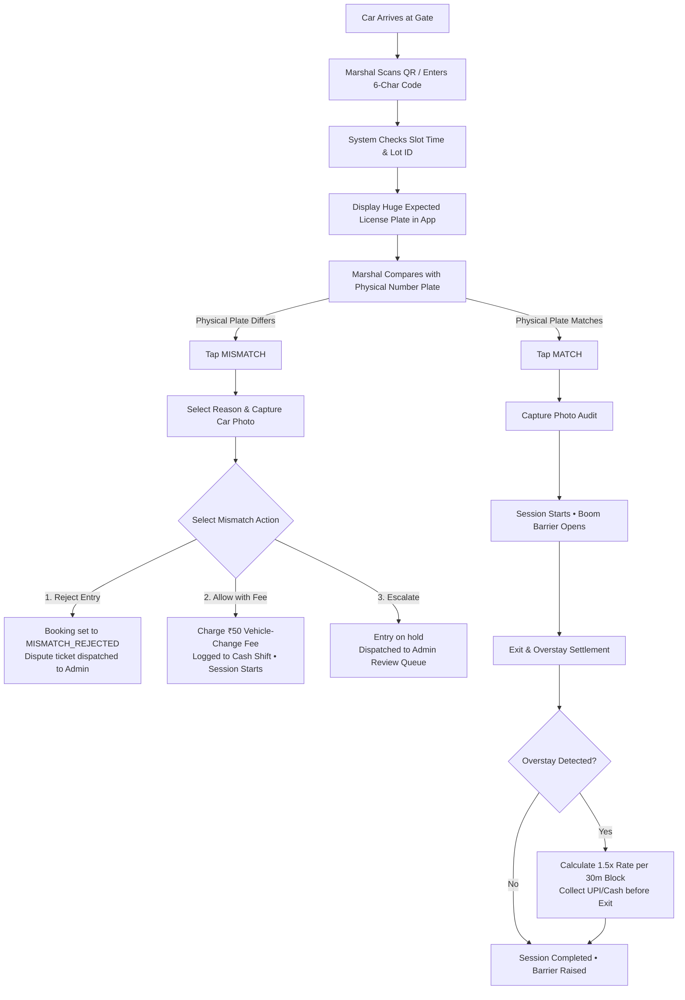

# Vehicle Verification & Gate Protocol

### Key Safety Edge Cases
1. **Early Arrival**: Check-in is locked until `start_time - 15 mins`.
2. **Expired / Cancelled Pass**: Gate scanner immediately warns attendant and blocks access.
3. **Wrong Lot QR**: Warns attendant that customer is at the wrong location with direct lot name.
4. **Discrepancy Reporting**: Attendant submits cash at shift close; system flags any shortage or surplus in the Admin ledger.
